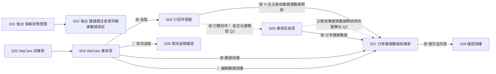

# 追蹤專家後自動顯示數據授權 快速確認
日期：2026-10-15　來源：整合Prototype（git 847fd61）— `site/index.html` 本機啟動實測（① 後台、② WaCare 手機端）＋原始碼；`ui-preview.html` 中途示意稿（.gitignore 標為非交付，只當作「當初意圖」參考）　模式：A 已有 prototype

> 說明
> - 沒有提供既有規格，所以本文件**不使用「全新發現」標籤**。
> - 沒有提供臨床規則表。本功能幾乎不涉及臨床門檻，「發現落差」只比對 prototype 內部前後文案、以及 prototype 與示意稿的差異。
> - 示範資料全部來自 prototype 內的假資料（示範診所、Bliss、小明）。

## 怎麼看這份文件
- 已確認：我實際點到，行為清楚。
- 待確認：需要拍板，見「待拍板表」。
- 未能實測：沒辦法點到或看到，只寫原因。

## 畫面連結圖

## 畫面卡

### S01　後台｜個案狀態管理（設定入口）　【已確認】
- 情境：機構後台的專家帳號操作者（待確認：角色，見 Q4）在個案列表頁，想設定「民眾追蹤我之後要看到什麼授權請求」。
- 實際觀察到的行為：
  - 「個案狀態管理」標題旁有「設定專家建議」按鈕，點擊開啟 S02。
  - 頁首登入身分顯示「示範診所／家醫科／個管中心」。
- 缺漏狀態：Empty 未見；Loading 無；Error 無
- 發現落差：分頁標籤寫「CasaVida 後台」，畫面 Logo 是「WaPro」（用詞，見用詞釐清）。
- 待確認：Q4
- 截圖：無（使用者沒有提供截圖）

### S02　後台｜「建議關注者提供健康數據」設定視窗　【已確認】
- 情境：專家帳號操作者勾選希望民眾分享的數據項目，並決定要不要開啟「主動收集健康數據」。
- 實際觀察到的行為：
  - 20 個可勾選項目，雙欄排列。第一次開啟時預設勾選：血糖、筆記、氣象、男性健康、回診。
  - 下方是本次新增的「主動收集健康數據」開關，預設「開啟」，說明文字：「開啟後，民眾追蹤此專家並關閉打招呼視窗時，會自動跳出數據授權頁，更主動收集民眾的健康數據。」
  - 按「儲存」後顯示「儲存成功!!」；重新開啟視窗時顯示上次儲存的狀態。
  - 切換開關但沒按儲存就按 ✕ 關閉，設定不生效。
  - 設定以專家帳號為單位保存；但 prototype 的民眾端判斷改為「未設定視為開啟」後，未設定過的專家（例如 Bliss）也會視為開啟，是否仍要維持不受影響，見 Q11。
- 缺漏狀態：Empty 不適用；Loading 無；Error 無（沒有儲存失敗的畫面）
- 發現落差：說明文字只寫「關閉打招呼視窗時」才觸發，但實測按「打聲招呼！」也會觸發（S06）。見 Q2。
- 待確認：Q2、Q4
- 截圖：無

### S03　WaCare｜找專家　【已確認】
- 情境：民眾在 WaCare App 找到想追蹤的專家。
- 實際觀察到的行為：
  - 「找專家」分頁可輸入關鍵字搜尋，搜「示範」出現「示範診所」，點擊進入 S04。
- 缺漏狀態：Empty 未實測（沒搜過查無結果）；Loading 無；Error 無
- 發現落差：列表卡片顯示「健康服務・4,242 位追蹤者」，進入專家頁顯示「醫療院所・128 位追蹤者」，屬示範資料不一致，不影響本功能。
- 待確認：無
- 截圖：無

### S04　WaCare｜專家頁（示範診所）　【已確認】
- 情境：民眾在專家頁決定要不要追蹤，追蹤後可以發訊息或授權數據。
- 實際觀察到的行為：
  - 未追蹤：按鈕為「訊息／發問／追蹤」。按「追蹤」後立刻出現 S05。
  - 已追蹤、未授權：按鈕變成「訊息／發問／數據授權／⋮」。
  - 已授權：「數據授權」按鈕消失。
  - 「⋮」選單：分享專家、發送訊息、討論區發問、編輯數據授權、取消追蹤。
- 缺漏狀態：Empty 不適用；Loading 無；Error 無（追蹤失敗沒有畫面）
- 發現落差：無
- 待確認：Q5
- 截圖：無

### S05　WaCare｜打招呼視窗　【已確認】
- 情境：民眾剛追蹤專家，系統歡迎並引導互動。
- 實際觀察到的行為：
  - 標題「感謝您關注示範診所專家」，說明「關注專家後，您可以向專家進行健康諮詢，或分享數據給專家…」，按鈕「打聲招呼！」，右上角 ✕。
  - 按 ✕：主動收集健康數據開啟、民眾尚未授權、且專家建議至少 1 項時，在專家頁上直接出現 S07。任一條件不符就只關閉視窗。
  - 按「打聲招呼！」：前往 S06（是否也要自動彈出見 Q2）。
- 缺漏狀態：Empty 不適用；Loading 無；Error 無
- 發現落差：示意稿 ① 的流程是「打招呼 → 訊息頁 → 自動彈出」，後台說明文字是「關閉打招呼視窗時」，兩者描述的觸發點不同。見 Q2。
- 待確認：Q2
- 截圖：無

### S06　WaCare｜專家訊息頁（示範診所）　【待確認】
- 情境：民眾和專家的聊天室，內含一則數據授權罐頭訊息。
- 實際觀察到的行為：
  - 兩則罐頭訊息：「歡迎加入示範診所…」及「如需更多健康建議，您可以選擇同意分享您的健康數據給我…」，後者附「分享健康數據」按鈕，點擊開啟 S07。
  - 從 S05 按「打聲招呼！」進來，且主動收集健康數據開啟、未授權、專家建議至少 1 項時，進入後自動彈出 S07。
  - 在 S07 按「取消」後回到聊天室，不會再自動彈出；之後從專家頁按「訊息」進入，也不會自動彈出。
  - 授權完成後，罐頭訊息的按鈕仍顯示「分享健康數據」且可點（沒有變成「已完成授權」）。
- 缺漏狀態：Empty 不適用；Loading 無；Error 無
- 發現落差：程式裡有「已完成授權」的按鈕樣式，但示範診所這個聊天室版型沒有套用，授權後按鈕不會改變。見 Q7。
- 待確認：Q2、Q6、Q7
- 截圖：無

### S07　WaCare｜分享健康數據給專家（授權頁）　【待確認】
- 情境：民眾決定要分享哪些健康數據給這位專家。
- 實際觀察到的行為：
  - 全螢幕頁，標題「分享健康數據給專家」，專家頭像與名稱，紅字「成功關注專家！」，說明「同意專家瀏覽您的資料…您可以隨時取消分享健康數據。（其他健康資料會陸續開放分享）」。
  - 三區：
    1. 個人檔案（附提醒：「您將分享個人檔案，包含出生年月日、身分證字號等個人機敏資訊，請再次做確認。」）
    2. 專家建議：列出後台 S02 勾選的項目，附說明「當出現『您尚未開啟』的健康燈項目，在您同意授權專家時系統將一併幫您開啟」；有全選勾選框。
    3. 您已開啟的健康數據：其餘項目，有全選勾選框。
  - 預設勾選：個人檔案＋專家建議全部項目；第 3 區全部不勾。
  - 底部按鈕「取消」「儲存並同意」。
  - 後台勾選 0 項時不會自動彈出（實測）；依程式碼，「專家建議」區在 0 項時整區隱藏（沒有手動點開驗證）。
  - 「您尚未開啟」的標示與「一併開啟」的行為：**未能實測**，原因是示範資料裡沒有任何項目處於「尚未開啟」狀態。
- 缺漏狀態：Empty 有（專家建議 0 項時隱藏，依程式碼）；Loading 無；Error 無
- 發現落差：示意稿 ③ 寫「項目預設不勾選」，整合 Prototype 是個人檔案和專家建議預設勾選。見 Q1。
- 待確認：Q1、Q8
- 截圖：無

### S08　WaCare｜確認授權視窗　【已確認】
- 情境：民眾在送出授權前做二次確認。
- 實際觀察到的行為：
  - 文案「再次確認是否授權分享健康數據給 示範診所 健康服務：」，下方列出已勾選項目（例：個人檔案、血糖、筆記、氣象、男性健康、回診）。
  - 全部取消勾選時，顯示「（尚未選擇任何項目）」，且仍可按「儲存授權」。
  - 按「儲存授權」：授權生效，專家頁「數據授權」按鈕消失。按「取消」回到 S07。
- 缺漏狀態：Empty 有（0 項時顯示「尚未選擇任何項目」）；Loading 無；Error 無（儲存失敗沒有畫面）
- 發現落差：文案固定寫「健康服務」，但示範診所的類別是「醫療院所」。見 Q8。
- 待確認：Q3、Q8
- 截圖：無

### S09　WaCare｜取消追蹤確認　【已確認】
- 情境：民眾不想再追蹤這位專家。
- 實際觀察到的行為：
  - 「⋮ → 取消追蹤」出現「您確定要取消關注嗎？…專家將無法繼續透過健康數據關心您。」，按「是的，取消關注」後取消追蹤並清除授權。
  - 重新追蹤後，S05 → S07 的自動彈出會再出現一次（實測）。
- 缺漏狀態：Empty 不適用；Loading 無；Error 無
- 發現落差：無
- 待確認：Q5
- 截圖：無

## 待拍板表
本輪問答只問 Q1–Q4，Q5–Q9 留到下一輪或交給標示的回答者。

| # | 問題 | 回指畫面 | 建議預設（附出處） | 回答者 | 回覆 |
|---|------|----------|--------------------|--------|------|
| Q1 | 自動彈出的授權頁，「個人檔案」和「專家建議」項目要預設勾選嗎？ | S07 | 兩個來源不一致：整合 Prototype 預設勾選（S07）；示意稿 ③ 寫「預設不勾選」。個人檔案含身分證字號，建議一併請個資窗口看 | 醫療部＋個資／法務窗口（待確認） | |
| Q2 | 在打招呼視窗按「打聲招呼！」（進入訊息頁），也要自動彈出授權頁嗎？ | S02、S05、S06 | 要（整合 Prototype S06 現況；示意稿 ① 的流程也是這樣）。若確認，後台說明文字需改寫 | 醫療部 | |
| Q3 | 民眾一個項目都沒勾，也能按「儲存授權」完成嗎？ | S08 | 可以（整合 Prototype S08 現況） | 醫療部 | |
| Q4 | 後台誰可以開關「主動收集健康數據」？ | S01、S02 | 無，請直接回答 | 醫療部 | |
| Q5 | 民眾取消追蹤後重新追蹤，要再自動彈出一次授權頁嗎？ | S04、S09 | 要（整合 Prototype S09 實測） | 醫療部（下一輪） | |
| Q6 | 民眾在自動彈出的授權頁按「取消」後，之後進訊息頁還要再自動彈出嗎？ | S06 | 不要，只彈一次（整合 Prototype S06 實測） | 醫療部（下一輪） | |
| Q7 | 授權完成後，聊天室罐頭訊息的按鈕要改成「已完成授權」並不可點嗎？ | S06 | 要（prototype 程式已有「已完成授權」樣式，只是此版型沒套用） | 產品／設計 | |
| Q8 | 確認授權文案的「健康服務」，要改成依專家類別顯示（例如醫療院所）嗎？ | S08 | 無，請直接回答 | 產品 | |
| Q9 | 專家建議裡「您尚未開啟」的健康燈，在同意授權時自動開啟，是否在本次範圍？ | S07 | 無，請直接回答（prototype 有文案，沒有可測的資料） | 醫療部（下一輪） | |
| Q10 | 這個功能的成功指標要看什麼、目標值多少？ | — | 無，請直接回答 | 產品／醫療部（下一輪） | |
| Q11 | 「主動收集健康數據」預設開啟，是只套用在示範診所，還是所有未設定過的專家都預設開啟？ | S01、S02 | 目前 prototype 為所有未設定專家（含 Bliss）都視為開啟；原規格為 Bliss 不受影響 | 醫療部 | |

## 用詞釐清
| 詞 | 本份文件採用的意思 | 誰確認 |
|----|--------------------|--------|
| 追蹤／關注 | 同一件事。WaCare 按鈕寫「追蹤」，視窗文案寫「關注」 | 待確認（產品） |
| 數據授權／分享健康數據 | 同一個授權頁。專家頁按鈕寫「數據授權」，聊天室按鈕與頁面標題寫「分享健康數據」 | 待確認（產品） |
| 主動收集健康數據 | 後台開關：開啟時，民眾追蹤後自動帶出授權頁。不代表自動授權，民眾仍需自己按儲存 | 待確認（醫療部） |
| 專家建議 | 後台勾選、希望民眾分享的項目，在授權頁成為獨立一區 | 待確認（醫療部） |
| 後台名稱 | 整合頁標籤叫「CasaVida 後台」，畫面 Logo 是「WaPro」，本文件統一稱「後台」 | 待確認（產品） |
| 項目名稱對照 | 後台 20 項與民眾端 24 項名稱不同，例如：體重→體重燈、問卷→問卷燈、頑固型血壓→頑固型高血壓、巴金森氏症→巴金森、用藥→用藥紀錄、數位社會處方→數位社會處方燈、風險預測→風險預測燈、飲食→飲食燈。民眾端多了血氧、癌歷、疲倦測試燈、照顧者 | 待確認（醫療部＋工程） |

---

# Proposal: auto-show-data-authorization-after-follow

## Background
民眾追蹤專家後，目前要自己找到「數據授權」才會分享健康數據。本次在後台新增「主動收集健康數據」開關：專家開啟後，民眾追蹤此專家時會自動帶出授權頁，讓專家更早拿到建議的健康數據。開關以專家帳號為單位，預設開啟。

## User Stories

### US-1: 專家在後台開關主動收集健康數據 [P1]
**As a** 後台專家帳號的操作者（待確認：角色，見 Q4）
**I want** 為我的專家帳號開啟或關閉「主動收集健康數據」
**So that** 新追蹤我的民眾一追蹤就會看到數據授權頁

**Acceptance Scenarios**
1. **WHEN** 操作者第一次開啟「建議關注者提供健康數據」設定 **THEN** 「主動收集健康數據」顯示為「開啟」
2. **WHEN** 操作者切換「主動收集健康數據」並按「儲存」 **THEN** 畫面顯示「儲存成功!!」，重新開啟設定時顯示剛才儲存的狀態
3. **WHEN** 操作者切換「主動收集健康數據」但沒按「儲存」就關閉視窗 **THEN** 設定維持原本狀態
4. **WHEN** 示範診所關閉主動收集健康數據 **THEN** 其他專家的設定不受影響（未設定過的專家預設為開啟）

**Independent Test**：在後台開關並儲存後重新開啟視窗，確認狀態；再到民眾端分別追蹤兩位專家，確認只有開啟的那位會自動彈出。
來源：S01、S02

### US-2: 民眾追蹤後自動看到授權頁 [P1]
**As a** 剛追蹤專家的 WaCare 民眾
**I want** 追蹤後直接看到要分享哪些健康數據
**So that** 不用自己找入口，就能決定要不要讓專家看我的數據

**Acceptance Scenarios**
1. **WHEN** 專家已開啟主動收集健康數據、民眾尚未授權、專家建議至少 1 項，且民眾追蹤後在打招呼視窗按 ✕ **THEN** 專家頁上直接出現「分享健康數據給專家」授權頁
2. **WHEN** 專家的主動收集健康數據為關閉 **THEN** 民眾追蹤後只看到打招呼視窗，不會自動出現授權頁
3. **WHEN** 專家建議為 0 項 **THEN** 即使主動收集健康數據開啟，也不會自動出現授權頁
4. **WHEN** 民眾已經授權過這位專家 **THEN** 不會自動出現授權頁

**Independent Test**：在後台分別設定「開啟／關閉」「建議 0 項／至少 1 項」，到民眾端追蹤並按 ✕，確認只有「開啟＋至少 1 項＋未授權」會彈出。
來源：S02、S04、S05、S07

### US-3: 民眾選擇項目並二次確認後完成授權 [P1]
**As a** 看到授權頁的 WaCare 民眾
**I want** 看清楚要分享的項目，並在送出前再確認一次
**So that** 不會誤把不想分享的資料給專家

**Acceptance Scenarios**
1. **WHEN** 授權頁出現 **THEN** 分成「個人檔案（附機敏資料提醒）」「專家建議」「您已開啟的健康數據」三區，每區都可以勾選或取消
2. **WHEN** 民眾按「儲存並同意」 **THEN** 出現「確認授權」視窗，列出目前勾選的項目
3. **WHEN** 民眾在確認視窗按「儲存授權」 **THEN** 授權生效，專家頁不再顯示「數據授權」按鈕
4. **WHEN** 民眾在授權頁按「取消」 **THEN** 授權頁關閉，沒有任何授權生效

**Independent Test**：自動彈出授權頁後，勾選部分項目並完成兩步確認，確認專家頁按鈕消失；另測一次按取消，確認按鈕仍在。
來源：S04、S07、S08

### US-4: 民眾之後仍可從其他入口授權或修改 [P2]
**As a** 已追蹤但當下沒有授權的 WaCare 民眾
**I want** 之後還能找到授權入口
**So that** 想清楚後再分享，或修改已分享的項目

**Acceptance Scenarios**
1. **WHEN** 民眾已追蹤但未授權 **THEN** 專家頁顯示「數據授權」按鈕，點擊開啟授權頁
2. **WHEN** 民眾在聊天室點罐頭訊息的「分享健康數據」 **THEN** 開啟授權頁
3. **WHEN** 已授權的民眾從專家頁「⋮ → 編輯數據授權」進入 **THEN** 授權頁帶入上次儲存的勾選狀態

**Independent Test**：追蹤後取消授權頁，分別從專家頁按鈕、聊天室按鈕進入；完成授權後再從 ⋮ 進入，確認勾選狀態保留。
來源：S04、S06、S07

### US-5: 後台的專家建議項目帶入民眾端授權頁 [P3]
**As a** 後台專家帳號的操作者（待確認：角色，見 Q4）
**I want** 我在後台勾選的建議項目出現在民眾授權頁的「專家建議」區
**So that** 民眾知道我最需要哪些數據

**Acceptance Scenarios**
1. **WHEN** 操作者在後台勾選項目並儲存 **THEN** 民眾端授權頁的「專家建議」區只列出這些項目（名稱依對照表轉換）
2. **WHEN** 某項目沒被勾選 **THEN** 它出現在「您已開啟的健康數據」區

**Independent Test**：後台改勾「血壓、體重、問卷」並儲存，民眾端授權頁的專家建議區應顯示「血壓、體重燈、問卷燈」。
來源：S02、S07

## Edge Cases
- 按「打聲招呼！」進訊息頁時是否也自動彈出：待確認，見 Q2。
- 自動彈出時項目預設勾選與否：待確認，見 Q1。
- 0 個項目也能儲存授權：待確認，見 Q3。
- 取消追蹤後重新追蹤：prototype 會再彈一次，待確認，見 Q5。
- 民眾按取消後再進訊息頁：prototype 不再彈，待確認，見 Q6。
- 授權後聊天室按鈕狀態：待確認，見 Q7。
- 「您尚未開啟」的健康燈在授權時自動開啟：未能實測，待確認，見 Q9。
- 授權或後台設定儲存失敗（網路錯誤）：prototype 沒有畫面，需補 Error 狀態。
- 專家在民眾追蹤之後才開啟主動收集健康數據：prototype 只在追蹤當下觸發，已追蹤的民眾不受影響。是否符合預期，建議下一輪一併確認。

## Functional Requirements
- FR-001：後台「建議關注者提供健康數據」設定必須新增「主動收集健康數據」開關，以專家帳號為單位保存，未設定過的專家預設為開啟。
- FR-002：開關必須按「儲存」才生效，並顯示儲存成功訊息。
- FR-003：民眾追蹤專家後關閉打招呼視窗時，若專家主動收集健康數據開啟、民眾尚未授權、專家建議至少 1 項，系統必須自動顯示授權頁。
- FR-004：任一條件不符時，系統不得自動顯示授權頁。
- FR-005：授權頁必須分為個人檔案、專家建議、其他已開啟數據三區；個人檔案區必須顯示機敏資料提醒。
- FR-006：送出授權前必須經過「確認授權」視窗，列出已選項目。
- FR-007：民眾取消授權頁後，必須仍可從專家頁「數據授權」與聊天室「分享健康數據」再次進入。
- FR-008：自動彈出的授權頁只是幫民眾帶出頁面，必須由民眾自己按儲存才算授權。

## Success Criteria
- SC-001：開啟主動收集健康數據的專家，新追蹤者完成數據授權的比例要達到多少：待確認，見 Q10。
- SC-002：關閉主動收集健康數據的專家，追蹤流程與上線前完全相同（可用 US-2 第 2 條驗證）。

## Related Modules
（工程填）

## Open Questions
- [ ] **NEEDS CLARIFICATION**（Q1，回答者：醫療部＋個資／法務窗口）：自動彈出的授權頁，個人檔案與專家建議要預設勾選嗎？
- [ ] **NEEDS CLARIFICATION**（Q2，回答者：醫療部）：按「打聲招呼！」進入訊息頁，也要自動彈出嗎？
- [ ] **NEEDS CLARIFICATION**（Q3，回答者：醫療部）：0 個項目也能完成授權嗎？
- [ ] **NEEDS CLARIFICATION**（Q4，回答者：醫療部）：後台誰可以開關主動收集健康數據？
- [ ] **NEEDS CLARIFICATION**（Q5，回答者：醫療部）：取消追蹤後重新追蹤，要再自動彈出嗎？
- [ ] **NEEDS CLARIFICATION**（Q6，回答者：醫療部）：按取消後再進訊息頁，還要自動彈出嗎？
- [ ] **NEEDS CLARIFICATION**（Q7，回答者：產品／設計）：授權後聊天室按鈕要改成「已完成授權」嗎？
- [ ] **NEEDS CLARIFICATION**（Q8，回答者：產品）：確認授權文案的「健康服務」要依專家類別顯示嗎？
- [ ] **NEEDS CLARIFICATION**（Q9，回答者：醫療部）：「您尚未開啟」健康燈的自動開啟是否在本次範圍？
- [ ] **NEEDS CLARIFICATION**（Q10，回答者：產品／醫療部）：成功指標與目標值？
- [ ] **NEEDS CLARIFICATION**（Q11，回答者：醫療部）：預設開啟的適用範圍？

## Constitution Check
（工程填）

## UI Scope
partial：後台設定視窗新增一個開關；民眾端沿用既有的打招呼視窗、授權頁、確認視窗，只新增「自動帶出」的觸發。

### 給工程的備註（不需醫療部回答）
- prototype 用瀏覽器 localStorage 存設定（`wacare-casavida-priority-auth-v2`、`wacare-casavida-expert-advice-v2`），專家 id 寫死為 `aimee`；正式版需改成以專家帳號存在伺服器端。
- `site/index.html` 每次開啟都會把主動收集健康數據重設為預設（開啟），這是 Demo 專用。
- 民眾的授權勾選只存在頁面記憶體，重新整理即消失。
- 後台與民眾端項目名稱需要一份正式對照表（見用詞釐清）。
- 所有畫面都沒有 Loading 與 Error 狀態。

---

## 輸出前自檢
- [x] 每個數字都有出處：文件中的數字只有 prototype 示範資料（追蹤者人數、20／24 項）與項目數條件「至少 1 項」，都標明來自 prototype；成功指標目標值沒有出處，已改為待確認（Q10）。
- [x] 每條 US 有「來源」回指：US-1～US-5 都有。
- [ ] **紅：每條 US 的角色是具體角色**。US-1、US-5 的後台操作者角色尚未確定，已標「待確認：角色，見 Q4」。
- [x] 每條 US 至少 2 條 WHEN/THEN（不含待確認項）：US-1 4 條、US-2 4 條、US-3 4 條、US-4 3 條、US-5 2 條。
- [x] AC 沒有 API、元件名、資料表：實作細節只出現在「給工程的備註」。
- [x] 未能實測的畫面沒有描述行為：S07 的「您尚未開啟」部分已標未能實測，沒有描述行為。
- [x] 「全新發現」標籤：沒有提供既有規格，全文未使用。
- [x] 待拍板表與 Open Questions 題號一致：Q1～Q11 兩邊一致，沒有漏題。
- [x] 每個畫面都註記了 Empty、Loading、Error：S01～S09 都有。
- [x] 本輪問答沒超過 4 題：本輪只問 Q1～Q4，累計第 1 輪；Q5～Q11 標為下一輪或其他回答者。
- [x] 文件裡沒有病患真實資料：只用 prototype 假資料（示範診所、Bliss、小明）。
- [ ] **紅：缺臨床規則表**，無法比對臨床內容。本功能不涉及臨床門檻，影響有限；落差只比對了 prototype 內部文案與示意稿。
